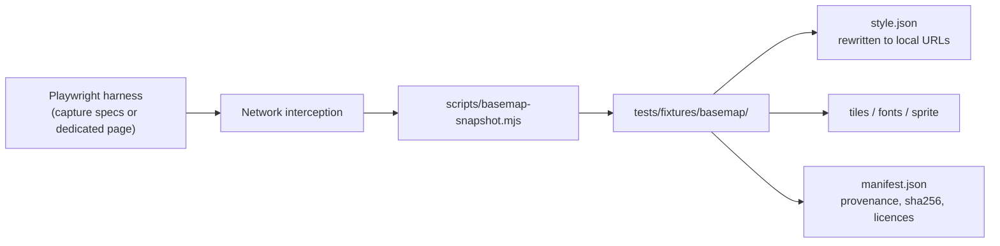

# Deterministic screenshots via a vendored basemap

> [!NOTE]
> **Status: proposal — not implemented.** This document describes a future change to the test and demo tooling. No snapshot script, vendored asset, or style swap exists yet. It is an internal engineering proposal and is not linked from the consumer documentation set.

## Summary

The browser suite captures seven PNG screenshots from maps that render remote tiles, glyphs and sprites. Repeated runs of an unchanged spec can produce different bytes for an identical scene: captures of the same spec have produced PNGs of 55,201, 71,459 and 63,924 bytes, with the only visible difference being the "Holberg Inlet" basemap label painting in or out. The settle pipeline in `tests/browser/helpers/screenshot.js:23` guarantees content readiness — bounded network idle, every `window.waymarkMaps` map idle with tiles loaded, every `` complete and decoded, `document.fonts.ready`, two animation frames — but not byte stability, because remote basemap assets arrive on network timing.

This document proposes vendoring the demo-area assets of the [OpenGIS basemap](https://github.com/OpenGIS/basemap) into `tests/fixtures/basemap/`, swapping the screenshot specs and the dev harness to the local copy, and hardening capture options so successive captures of the same scene are byte-identical on a given platform. A self-contained demo — no external basemap requests — follows as a side effect.

> [!WARNING]
> Cross-platform byte identity (macOS development versus Ubuntu CI) is a stretch goal, not an assumption. See [Validation](#validation).

## Current state

| Concern                       | Location                                                    |
| ----------------------------- | ----------------------------------------------------------- |
| API screenshot specs          | `tests/browser/1.api.test.js:1005` (`Screenshots` describe) |
| Dev-page screenshot specs     | `tests/browser/2.development.test.js:31`                    |
| Shared capture helper         | `tests/browser/helpers/screenshot.js:111` (`screenshot`)    |
| Settle pipeline               | `tests/browser/helpers/screenshot.js:23` (`waitForSettled`) |
| Screenshot output             | `screenshots/` at the repo root — 7 PNGs, tracked in git    |
| Default style — API specs     | `tests/browser/1.api.test.js:1006` (`apiDefaultVector`)     |
| Default style — dev harness   | `dev/dev.js:16` (`STYLE_URL`)                               |
| Fixtures served at `/`        | `vite.config.dev.js:8` (`publicDir` → `tests/fixtures`)     |
| Browser suite server and port | `playwright.config.js:3` (`127.0.0.1:4173`)                 |

The seven captures are `api-quick-start`, `api-geojson-families` and `api-geojson-mixed` from `tests/browser/1.api.test.js:1018,1074,1175`, plus `dev-page`, `dev-layer-added`, `dev-popup` and `dev-popup-line` from `tests/browser/2.development.test.js:49,84,165,263`. Both the specs and the dev harness currently render on **OpenFreeMap Bright** (`dev/dev.js:16`, `tests/browser/1.api.test.js:1006`).

The OpenGIS basemap's own screenshot pipeline waits a fixed 750 ms for tiles and labels before capture. That is the same mitigation class — a timing tolerance — and not a determinism guarantee either.

## Goal and scope

**Goal:** byte-stable (pixel-perfect) screenshots and a self-contained demo by vendoring the OpenGIS basemap's demo-area assets into the repository.

**Demo area:** north Vancouver Island (Cape Scott → Port Hardy, anchored on Holberg), roughly lon `[-128.6, -127.2]`, lat `[50.5, 50.95]`. This is the area the fixtures and tests already use; the current fixture coordinates span lon `[-128.428, -127.490]`, lat `[50.649, 50.785]`, so the proposed box contains every fixture plus framing margin for the capture viewports.

## The upstream basemap

### Repository and host

- Repository: [OpenGIS/basemap](https://github.com/OpenGIS/basemap), branch `master`.
- Canonical host: `https://www.ogis.org/basemap/`. The legacy `*.github.io` host 301-redirects and breaks CORS — it must never be used.
- All published assets are open-CORS:
  - style: `https://www.ogis.org/basemap/style.json`
  - glyphs: `https://www.ogis.org/basemap/fonts/{fontstack}/{range}.pbf`
  - sprite: `https://www.ogis.org/basemap/sprite` (plus `@2x`)
  - icons: `https://www.ogis.org/basemap/icons/{name}.svg`

### Style and tiles

The style ("Basemap") is the OpenMapTiles "OSM" vector style v3.16 (248 layers), repointed at OpenFreeMap's worldwide planet tiles:

- TileJSON: `https://tiles.openfreemap.org/planet`
- OpenMapTiles schema: v3.16.0
- **maxzoom 14**, free, no API key, CORS-open.

> [!NOTE]
> The dev page zooms to 15 (`dev/dev.js:18`), so its z14 tiles are overzoomed by one level. That is deterministic and visually acceptable, but it is worth flagging when the vendored tiles are recorded and reviewed.

### Fonts, sprite and icons

- `fonts/` holds 21 fontstack directories (10 single and 11 comma-merged stacks) with 256 PBF ranges each: **~450 MB total**. Wholesale vendoring is not an option; snapshot only the glyph ranges the captures actually request.
- The sprite sheets cover 306 icons, and `icons/` holds 306 SVGs. MapLibre requests the sprite at runtime, so the sprite sheets are what need vendoring; the SVG set is recorded for provenance only unless the recorder shows otherwise.

### Licences to preserve

| Asset                   | Licence      |
| ----------------------- | ------------ |
| OSM data                | ODbL-1.0     |
| OpenFreeMap             | MIT          |
| OpenMapTiles style code | BSD-3-Clause |
| Design / cartography    | CC-BY-4.0    |
| Open Sans               | Apache-2.0   |
| Noto Sans               | OFL-1.1      |

Attribution is baked into the style — "OpenFreeMap · © OpenMapTiles · Data from OpenStreetMap" — and must be preserved verbatim in the vendored copy. The manifest will record the licence note for each asset.

## Proposed design

### 1. Vendoring destination

All vendored assets would live under `tests/fixtures/basemap/`, served automatically by the existing dev-server `publicDir` mapping: `tests/fixtures/basemap/style.json` becomes `/basemap/style.json`. The Playwright suite boots the same Vite configuration on `127.0.0.1:4173` (`playwright.config.js:3,18`), so the dev harness and the specs would both reach the local assets with no new server or config.

Sketch layout:

| Path                                                           | Contents                                                              |
| -------------------------------------------------------------- | --------------------------------------------------------------------- |
| `style.json`                                                   | OpenGIS "Basemap" style, rewritten to local URLs                      |
| `tilejson.json`                                                | Local TileJSON pointing at `tiles/`                                   |
| `tiles/{z}/{x}/{y}.pbf`                                        | Demo-area vector tiles recorded from `/planet`                        |
| `fonts/{fontstack}/{range}.pbf`                                | Only the glyph ranges MapLibre actually requested                     |
| `sprite.json`, `sprite.png`, `sprite@2x.json`, `sprite@2x.png` | Sprite sheets (306 icons)                                             |
| `manifest.json`                                                | Provenance: source URL → local path, sha256, fetch date, licence note |

### 2. Snapshot mechanism: record then vendor

A future `scripts/basemap-snapshot.mjs` would drive the existing capture specs — or a small dedicated harness page — under Playwright with network interception, and record every external basemap request: TileJSON, tiles, glyph ranges and sprite (and icons, if requested). Each response would be downloaded into the mirror layout, `style.json` would be rewritten to local URLs, and `manifest.json` would be written alongside.

This fetches exactly what the captures need: no bespoke tile maths, no 450 MB font dump. Refreshing the snapshot is a deliberate act — re-run the script, review the manifest and asset diff, commit.

### 3. Consumers of the vendored style

- **Screenshot specs** — swap `apiDefaultVector.styleURL` (`tests/browser/1.api.test.js:1006`) to the local style URL. The dev-page captures would inherit the swap through the dev harness.
- **Dev harness** — swap `dev/dev.js:16` (`STYLE_URL`) to the local style. Recommended: it freezes the demo look and removes the external dependency from `npm run dev`.
- **Library consumers** — unaffected. The live `https://www.ogis.org/basemap/style.json` stays the documented example ("use this style directly"); vendoring is test and demo infrastructure, not a shipped default.

### 4. Determinism hardening beyond local assets

Local assets remove the network-timing race, but several rendering choices should also be pinned in the capture maps:

- `fadeDuration: 0` on capture maps, to kill symbol fade transitions.
- No camera animation: use `jumpTo`, never `flyTo`/`easeTo`, in capture paths.
- Fixed viewport and device scale factor in the Playwright project rather than relying on device-profile defaults.
- Pinned Chromium — already the case through the lockfile (`@playwright/test` in `package.json`).
- Consider `--force-color-profile=srgb` as a launch flag.
- Software rasterisation only if hash validation demonstrates GPU variance.
- Keep `waitForSettled` — it is still needed for images and fonts even when every basemap byte is local.

## Validation

1. Run the capture suite at least three times on the same machine and compare the sha256 of all seven PNGs. Target: **same-platform byte stability**.
2. Optionally add a future `npm run screenshots:verify` that runs the capture suite twice and compares hashes, for CI or local confidence.
3. Cross-platform byte identity (macOS development versus Ubuntu CI) is a stretch goal. MapLibre renders text from SDF glyph PBFs — no system fonts — which removes one class of variance, but Skia rasterisation may still differ across platforms. The honest options are per-platform baselines or a Playwright `maxDiffPixels` tolerance. This is an open question, not a promise.

## Sizing and effort estimate

- Expected repository growth: a few MB — tens of tiles, the glyph ranges the requested fontstacks actually use, and the sprite.
- Estimated work: roughly three slices —
  1. snapshot script + manifest;
  2. serve the assets and swap the specs and dev harness;
  3. hardening + multi-run validation + docs.
- About 1–2 build dispatches, roughly half a day of agent time.

## Risks and open questions

- **Cross-platform bytes** — see [Validation](#validation); per-platform baselines or a pixel tolerance may be required.
- **Are `icons/` SVGs ever fetched at runtime?** The sprite is what MapLibre requests, but the recorder will reveal whether anything else is.
- **Repository size** — bounded by capture viewports, but it must be watched; the snapshot is explicit rather than exhaustive for that reason.
- **ODbL attribution obligations** — the baked-in attribution must survive the rewrite and stay visible; the manifest records the licence note per asset.
- **CI determinism validation** — a double-run comparison doubles CI capture cost; whether that is worth it is undecided.
- **Wider offline demo pyramid** — a wider tile pyramid would help offline development but inflate the repo. Recommendation: no; keep scope to the capture viewports.

## Non-goals

- Not implemented in this session; no script, asset or style change lands with this proposal.
- No worldwide tile vendoring.
- No public API changes; library consumers are unaffected.
- Not part of the consumer docs set — it is not linked from `docs/llms.txt`, `README.md` or any other doc.
