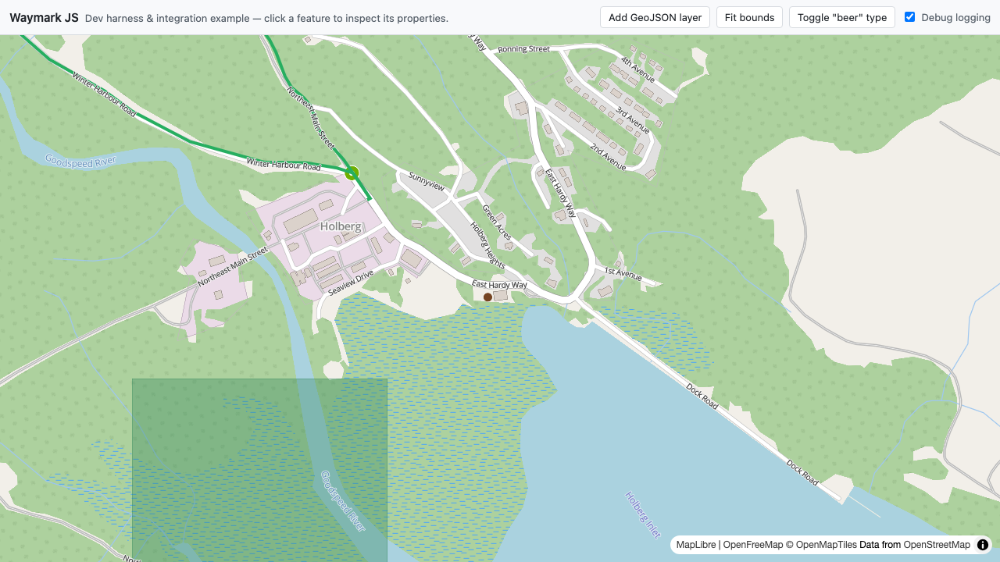
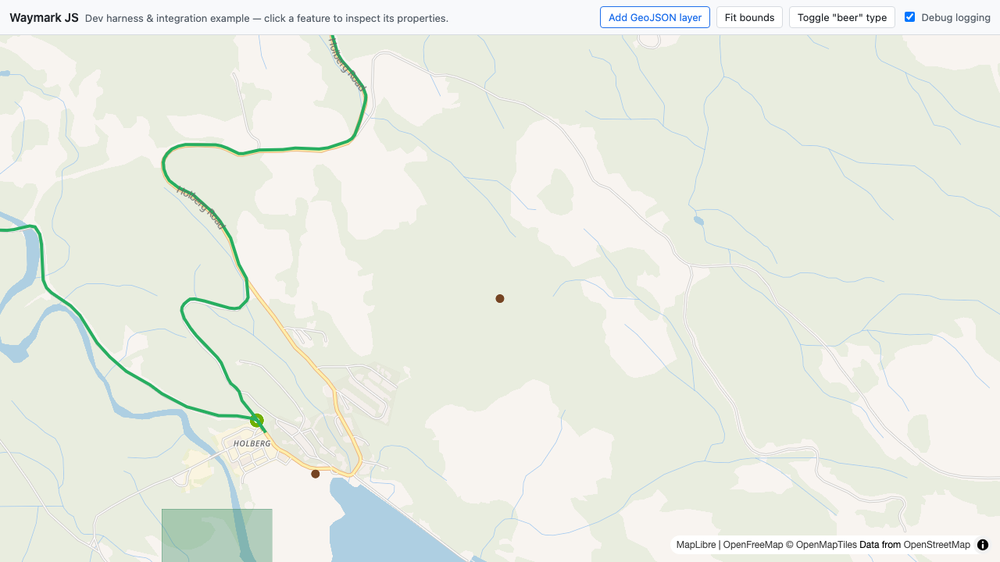

# Development

> Contributor workflow and verification protocol for Waymark JS.

## Contributor workflow

1. Install dependencies: `npm install`
2. Start dev server: `npm run dev`
3. Run formatting: `npm run format`
4. Verify formatting: `npm run format:check`
5. Regenerate `docs/llms-full.txt` and run docs/API sync checks: `npm run docs:sync` (`test:ci` first runs `npm run check:llms`, which fails if the committed bundle is stale)
6. Preview and build the docs site: `npm run docs:dev` (Nuxt dev server; defaults to `http://localhost:3000`) and `npm run docs:generate` (builds the deployable static site to `docs/.output/public`)
7. Run unit tests: `npm test`
8. Build and verify the dist output: `npm run build && npm run check:dist`
9. Run browser tests: `npm run test:browser`
10. Run the full CI gate locally: `npm run test:ci` (format check → llms bundle check → docs sync → build → dist check → docs generate → unit tests → browser tests).

`npm run test:browser` boots a dedicated Playwright Vite server on `127.0.0.1:4173` with `--strictPort`, so browser tests are deterministic even when your normal dev port is occupied. Browser tests import `src/entry.js` directly — the built bundle is verified separately by `npm run check:dist` and the Vitest dist smoke test. `playwright.config.js` pins `workers: 1` and `retries: 1` because the suite includes WebGL/shader and remote-network-dependent map tests that flake under parallel workers; single-worker execution was verified fully green.

`npm run docs:sync` chains `node scripts/llms-full.mjs`, `npm run docs:contract`, and `npm run docs:api-sync` (which runs `api:contract` first). The generator step rebuilds [`docs/llms-full.txt`](llms-full.txt) — the full content of every doc linked in [`docs/llms.txt`](llms.txt), concatenated into one file for single-fetch consumption. Both `docs/llms.txt` and `docs/llms-full.txt` are also published as tracked, byte-for-byte copies under `docs/public/` for repository indexing; `docs:sync` refreshes those copies and `npm run check:llms` verifies them. `test:ci` runs the generator in check mode first (`npm run check:llms`), so a stale committed bundle fails the gate before `docs:sync` regenerates it. No root `SKILL.md` is generated; consumer-facing agent docs follow the llms.txt convention and are distributed with the docs GitHub Pages deploy (see [Docs site](#docs-site)).

Vite config is split by role: `vite.config.dev.js` for local dev server, `vite.config.lib.js` for library builds, and `vitest.config.js` for tests.

`vite.config.lib.js` defines `process.env.NODE_ENV` as a build-time replacement for the dist bundle, preventing browser runtime errors like `process is not defined`. It also keeps `maplibre-gl` external (`rollupOptions.external`), so the build emits a single ESM bundle — `dist/waymark.js` (~31.5 kB, ~8.8 kB gzip) with a bare `maplibre-gl` import, no CSS and no inlined worker. `npm run check:dist` guards that output shape.

## Conventions and definitions

- **Instance**: public object returned by `createInstance({ map, document? })`.
- **Map injection**: the consumer creates and owns the MapLibre map; Waymark duck-types and mounts its overlay onto it.
- **Runtime core**: internal lifecycle object in `src/runtime/createInstanceCore.js`.
- **Runtime registry**: internal `WeakMap` from map → core in `src/runtime/runtimeRegistry.js` (one runtime per map).
- **InstanceDocument**: canonical serialisable payload from `instance.toJSON()` (the `document` option).
- **GeoJSON**: map data format and symbol naming (`createGeoJSONModule`, `geoJSON`).
- **Data layers**: canonical shape is `data.layers: Array<{ type?: "geojson", data: object }>`.
- **Feature interaction**: click/hover/leave event resolution in `src/geojson/createFeatureInteractionModule.js`; popups and cursor styling are consumer-owned.
- **Type icons**: `config.types[].icon` is a name hook for a consumer-registered map image (`map.addImage`); Waymark ships no icon assets and never registers images itself. The dev playground registers an inline `photo-marker` PNG this way and maps it to the `photo` type.

Keep runtime internals internal. Consumer docs and tests should target public API behaviour.

## Naming conventions

Use camelCase identifiers, with acronyms kept uppercase.

- `instanceDocument`
- `InstanceDocument`
- `geoJSON`

Use `instanceDocument` as the canonical variable/parameter name for the document payload, and `map` for the injected MapLibre map.

Prefer these canonical forms in source, tests, docs, and fixtures.

For data-layer ordering, use these canonical rules in docs/tests/fixtures:

- `data.layers` is the canonical data envelope.
- layer input shape is `{ type?: "geojson", data }` and runtime `instance.data.addLayer(...)` uses the same contract.
- data-layer stack order is top-first: `layers[0]` is visually on top.
- insertion position is below the first `symbol` layer already present in the injected map style (appended when none exists).

For full data/GeoJSON contract details, prefer [`docs/5.data.md`](5.data.md) rather than duplicating rules in multiple docs.

## Cross-module sync pattern (runtime-state owned)

Use this pattern when runtime modules must stay in sync.

1. **Runtime state owns mutable state**
   - Keep authoritative mutable state in `src/runtime/state/createInstanceState.js`.
   - `createInstanceCore(...)` owns lifecycle orchestration and commands, not duplicate mutable state copies.
   - Modules and adapters consume snapshots and never become a second source of truth.
2. **Dispatch named commands**
   - Route mutations through explicit dispatch paths (for example `types.visibility.set`, `types.visibility.reset`, `debug.set`).
   - Runtime commands dispatch state changes, then adapters apply map-side effects.
3. **Emit canonical state events**
   - Every real state mutation emits `waymark:state.changed` plus a scoped state event (`waymark:state.debug.changed`, `waymark:state.types.visibility.changed`).
   - No-op dispatches emit nothing.
4. **Emit data-layer events only where useful**
   - The GeoJSON module emits `waymark:data.layer.added`, `waymark:data.layer.mounted`, and `waymark:data.layer.error` for layer lifecycle observability.
5. **Emit feature interaction events from layer observation**
   - The feature interaction module emits `waymark:feature.click`, `waymark:feature.hover`, and `waymark:feature.leave` with `{ id, feature, layerId, lngLat, originalEvent }`.
   - These are observability events only: they do not mutate runtime state, the map cursor, or the camera.

Guidance for future sync features:

- keep mutation logic in runtime core, not in map adapters
- keep commands idempotent and no-op on invalid/unchanged input
- emit events only after state mutation succeeds
- prefer one aggregate event per mutation path over multiple partial events
- ensure `instance.toJSON()` reflects the same post-mutation state as emitted events

## Testing strategy

- `tests/docs/*.test.js` (Vitest + jsdom): API contract tests without WebGL.
- `tests/docs/runtime/createInstanceState.test.js`: runtime-state module contract (`getSnapshot`, command dispatch, scoped/global state events, no-op behaviour).
- `tests/docs/dist.smoke.test.js`: imports the built `dist/waymark.js` with `maplibre-gl` mocked, asserting `createInstance` exists and constructs `LngLatBounds` through the mock. It skips cleanly when `dist/` is absent and runs for real in `test:ci`, which builds first.
- `tests/browser/*.test.js` (Playwright): browser API and dev-page smoke. `1.api.test.js` covers feature interaction events (click/hover/leave detail, hover suppression, leave semantics, destroy cleanup) and the API screenshot specs; those specs fetch the shared fixtures (`/geojson/markers.json`, `/geojson/track-port-hardy-cape-scott.geojson`, `/geojson/shapes.json`, `/geojson/sample-point.geojson`) from the dev server. `2.development.test.js` covers the dev page: initial render, adding a layer, the consumer-side property-inspector popup (title, image, property rows), the marker/line/shape image fallbacks (thumbnail → medium → large), line and shape popup anchoring at the click location, and type visibility toggling.
- `tests/browser/helpers/screenshot.js`: shared capture helper. `screenshot(page, name)` awaits `waitForSettled(page)` before capturing; `waitForSettled` runs bounded waits for network idle, every `window.waymarkMaps` map to be idle with tiles loaded, every `` to be complete and decoded, `document.fonts.ready`, and two animation frames. This prevents blank or partially painted captures when tiles, images, or fonts arrive late. Screenshots are written to `screenshots/` at the repo root.

`npm run check:dist` statically asserts the built output: `dist/` contains only `waymark.js`, the bundle imports `maplibre-gl` as a bare external, and there is no base64 worker blob, no CSS and no Vue markers. `test:ci` runs it after `npm run build`.

Use jsdom tests to validate API contract behaviour, not as proof of non-browser runtime support. Browser tests are the runtime source of truth for instance behaviour.

## Dev page setup

The development playground lives under `dev/` as a vanilla ES module app (`dev/index.html`, `dev/dev.js`). Its data is the shared fixture set under `tests/fixtures/` — the single source of truth for the dev harness and the browser tests. `vite.config.dev.js` points `publicDir` at `tests/fixtures`, so the dev server serves the north Vancouver Island demo fixtures at `/`: `route.json` (config) and `geojson/` data. `dev/dev.js` imports `maplibre-gl/dist/maplibre-gl.css` (MapLibre requires its stylesheet for popup positioning), creates its own MapLibre map on `#map` (OpenFreeMap Bright style, initial centre on Holberg), and injects it via `createInstance({ map, document })`, booting one instance from `/route.json` plus four GeoJSON layers (`track-north-island.geojson`, `track-port-hardy-cape-scott.geojson`, `markers.json`, `shapes.json`) from `/geojson/`. It also fetches `/geojson/sample-point.geojson` for the add-layer control.



Before `createInstance(...)`, the harness registers an inline PNG data URL as the `photo-marker` image (`map.loadImage` + `map.addImage`), so the `photo` type's symbol layers resolve the icon from first mount. It also demonstrates the consumer-owned feature interaction pattern: a `Popup` property inspector on `waymark:feature.click`, and cursor changes on `waymark:feature.hover` / `waymark:feature.leave`.

The click inspector renders a title heading, a single `` when any image URL property is present, and the remaining properties as key/value rows. The image URL is picked in preference order `image_thumbnail_url` → `image_medium_url` → `image_large_url`, the image `alt` is the feature title (or `Feature image`), and all three `image_*_url` keys are omitted from the rows whenever an image is displayed. The popup anchors at `feature.geometry.coordinates` for Point geometry, and at the click `lngLat` for everything else. The harness emits no `[waymark:dev]` diagnostic logs during normal operation — interaction feedback lives in the inspector.

Vite dependency pre-bundling breaks MapLibre's worker: MapLibre resolves its worker relative to its own module URL, and Vite's pre-bundled copy under `node_modules/.vite/deps/` has no worker file alongside it, so GeoJSON source processing silently stalls (`map.loaded()` never becomes `true`). `vite.config.dev.js` sets `optimizeDeps.exclude: ["maplibre-gl"]` so the package is served as-is. Vite consumers of Waymark should do the same in their own config.

`dev/index.html` renders a restrained toolbar — the Waymark JS title plus a "click a feature to inspect its properties" cue — with four grouped controls:

- `#dev-add-layer` calls `instance.data.addLayer({ data: samplePoint }, { fitBounds: true })`; `samplePoint` carries `waymarkType: "beer"`
- `#dev-fit-bounds` calls `instance.data.fitBounds()`
- `#dev-toggle-beer` toggles `instance.types.setVisibility("beer", ...)`
- `#dev-debug` (checkbox) toggles `instance.debug.setEnabled(...)` console logging; it initialises checked from `config.debug` in `route.json` (`true`)



Fixture notes:

- `tests/fixtures/route.json` gives every type a `title`, maps the `photo` type to `icon: "photo-marker"` with `iconSize`, defines the `area` fill type (`fill-color: "#2f855a"`), and enables debug logging.
- The GeoJSON fixtures under `tests/fixtures/geojson/` (`markers.json`, `track-north-island.geojson`, `track-port-hardy-cape-scott.geojson`, `shapes.json`, `sample-point.geojson`) carry `waymarkType` only — the legacy duplicated `type` property has been removed.
- `shapes.json` holds a single `waymarkType: "area"` Polygon ("Cape Scott trail area") that carries only `image_medium_url`, exercising the medium fallback in the popup.
- `sample-point.geojson` sits in-scene at `[-127.998, 50.661]`; the add-layer browser test asserts that centre after `fitBounds`.
- Holberg (the pub "The Scarlet Ibis" at `[-128.009734, 50.653923]`) is the demo-closeup anchor, and the big route line is `track-port-hardy-cape-scott`.

The page exposes `window.waymarkInstance`, `window.waymarkInstances` and `window.waymarkMaps` (both keyed by the dev map key `map`), and `window.createWaymarkInstance` for manual console testing.

This gives a stable baseline for browser smoke coverage in `tests/browser/2.development.test.js`:

- the toolbar controls, `#map`, and the map canvas render with zero console errors
- adding a layer increases `data.layers` and fits bounds to the sample point
- clicking a marker opens the property-inspector popup (title, image, property rows) and loads the `image_thumbnail_url`
- clicking a track line opens the popup anchored at the click location and loads the `image_large_url`
- clicking a shape opens the popup with its properties and loads the `image_medium_url`
- image URL keys never render as raw URL text rows in any popup
- toggling the "beer" type hides and restores typed visibility

Run:

```bash
npm run format:check
npm run docs:sync
npm run docs:generate
npm test
npm run build && npm run check:dist
npm run test:browser
```

## Docs ↔ tests sync protocol

Treat docs and tests as one contract. Change both in the same slice.

| Docs page             | Unit tests                                                   | Browser tests                                            |
| --------------------- | ------------------------------------------------------------ | -------------------------------------------------------- |
| `docs/1.api.md`       | `tests/docs/1.api.test.js`                                   | `tests/browser/1.api.test.js`                            |
| `docs/3.instances.md` | Internal-boundary assertions in `tests/docs/1.api.test.js`   | Dev smoke in `tests/browser/2.development.test.js`       |
| `docs/4.map.md`       | Map injection assertions in `tests/docs/1.api.test.js`       | Map API coverage in `tests/browser/1.api.test.js`        |
| `docs/5.data.md`      | Data-layer contract assertions in `tests/docs/1.api.test.js` | Data-layer API coverage in `tests/browser/1.api.test.js` |

Automation guards:

- `npm run docs:contract` checks required docs headings and mapped test `describe(...)` blocks.
- `npm run docs:api-sync` checks API sections in `docs/1.api.md` against generated source contract data.

Keep [`docs/llms.txt`](llms.txt)'s links and descriptions in step when the docs set changes; [`docs/llms-full.txt`](llms-full.txt) regenerates from them via `npm run docs:sync` and is never hand-edited. After editing any doc linked from `docs/llms.txt`, run `npm run docs:sync` so the committed bundle stays fresh — otherwise `npm run check:llms` (and therefore `test:ci`) fails.

## Hard sync workflow (docs ↔ source ↔ tests)

`npm run docs:sync` is intentionally strict and should be treated as a hard gate before tests. CI runs `npm run check:llms` before regenerating, so a stale committed `docs/llms-full.txt` fails the gate instead of being silently overwritten.

Execution order:

1. `node scripts/llms-full.mjs`
   - Reads the `.md` links from `docs/llms.txt` in order and regenerates `docs/llms-full.txt` (stripping frontmatter and api-contract markers).
2. `npm run docs:contract`
   - Reads `scripts/doc-test-contract.json`.
   - Verifies required headings in tracked docs pages (`docs/1.api.md`, `docs/4.map.md`).
   - Verifies mapped `describe(...)` block names in `tests/docs/1.api.test.js` and `tests/browser/1.api.test.js`.
3. `npm run docs:api-sync`
   - Runs `npm run api:contract` first, generating `docs/.generated/api-contract.json` from `src/runtime/createInstanceEvents.js` (event constants) and `src/config/defaults.js` (`defaultConfig`), together with the fixed `createInstance({ map, document? })` signature.
   - Compares marker blocks in `docs/1.api.md` (`signature`, `defaults`, `lifecycle-events`, `data-layer-events`, `feature-events`) against generated contract values.

If this gate fails, fix docs headings/marker blocks and corresponding test `describe(...)` names in the same change.

## Adding or changing API sections safely

Use this convention whenever you add, rename, or remove a section in `docs/1.api.md`.

### API section naming

- Use stable heading text in sentence case (for example, `## InstanceDocument shape`).
- Treat each heading name as automation-backed contract text, not editorial copy.

### One-to-one heading and `describe(...)` mapping

- Each API section heading in `docs/1.api.md` must have matching `describe(...)` blocks in:
  - `tests/docs/1.api.test.js`
  - `tests/browser/1.api.test.js`
- The `describe(...)` names must be identical to the heading text.

### Manifest updates

- When adding or renaming an API section, update `scripts/doc-test-contract.json` in the same change:
  - `requiredHeadings`
  - `describeMappings`

### Marker blocks for source-derived facts

- Source-derived API facts in `docs/1.api.md` must be wrapped in marker blocks:

```html
<!-- api-contract:<name>:start -->
...
<!-- api-contract:<name>:end -->
```

- Keep `<name>` stable once introduced.

### Extending source-derived contract fields

- If you add a new source-derived contract field, update all three in the same change:
  1. `scripts/generate-api-contract.mjs`
  2. `scripts/check-api-doc-sync.mjs`
  3. The matching marker block in `docs/1.api.md`

### Practical checklist

1. Add or rename the API section heading in `docs/1.api.md` (stable sentence case).
2. Add or rename matching `describe(...)` blocks in both API test files with identical names.
3. Update `scripts/doc-test-contract.json` (`requiredHeadings` and `describeMappings`).
4. If the section includes source-derived facts, add or update the `api-contract` marker block.
5. If you introduced a new source-derived field, update both sync scripts and the marker block together.
6. Run `npm run format:check` and `npm run docs:sync` before handing off.

Sync checklist:

1. Update the relevant docs headings and examples.
2. Update matching `describe(...)` blocks and assertions.
3. Run `npm run docs:sync`, `npm test`, and `npm run test:browser`.
4. Ensure old filenames/headings are removed.

## Screenshots

Browser tests capture screenshots as visual evidence of key application states. They are written to `screenshots/` at the repo root (tracked in git) by `tests/browser/helpers/screenshot.js`.

Every capture is settle-aware: `screenshot()` awaits the shared `waitForSettled(page)` helper before capturing. The helper runs bounded waits for network idle, every registered `window.waymarkMaps` map to be idle with tiles loaded, every `` to be complete and decoded, `document.fonts.ready`, and two animation frames. This prevents blank or partially painted captures when tiles, images, or fonts arrive late.

### API tests (`/browser-api.html`)

The API screenshot specs load the shared fixtures over the dev server (`markers.json`, `track-port-hardy-cape-scott.geojson`, `shapes.json`) and frame them on a Holberg closeup (centre `[-128.0145, 50.6525]`, zoom 14) so the point, line, and polygon all sit in frame.

| Screenshot             | What it shows                                                                  |
| ---------------------- | ------------------------------------------------------------------------------ |
| `api-quick-start`      | Injected map with a GeoJSON layer (demo markers) rendered on OpenFreeMap tiles |
| `api-geojson-families` | Circle (point), line, and fill (polygon) geometry families rendered            |
| `api-geojson-mixed`    | Point, line, and polygon sublayers from one mixed FeatureCollection            |

### Development page (`/` — dev server)

| Screenshot        | What it shows                                                               |
| ----------------- | --------------------------------------------------------------------------- |
| `dev-page`        | Default dev page state — toolbar, map, and the four initial fixture layers  |
| `dev-layer-added` | GeoJSON layer added from the toolbar, bounds fitted to `[-127.998, 50.661]` |
| `dev-popup`       | Feature inspector popup open after clicking the "The Scarlet Ibis" marker   |
| `dev-popup-line`  | Line popup anchored at the click location, with the feature's image         |

## Docs site

The docs site is a Nuxt static-site app that lives entirely under `docs/`: [`docs/nuxt.config.js`](nuxt.config.js) configures it, source lives in `docs/app/`, the build module in [`docs/modules/docs-pages.js`](modules/docs-pages.js), and the internal `/api/docs/*` routes in `docs/server/`. `npm run docs:dev` (`nuxt dev docs`) serves it locally for previewing prose changes; `npm run docs:generate` (`nuxt generate docs`) prerenders every route and writes the deployable site to the generated `docs/.output/public`.

At build time the module packages the site: it copies the tracked `screenshots/` directory, `llms.txt`, `llms-full.txt` and [`docs/assets/waymark-logo.svg`](assets/waymark-logo.svg) (as the site favicon) into the generated `docs/public/` (served verbatim), then renders each page once with [`docs/app/lib/docs-content.mjs`](app/lib/docs-content.mjs) into JSON assets under `docs/server/assets/docs-pages/`, which the `/api/docs/nav` and `/api/docs/[slug]` routes read. The `docs/public/llms.txt` and `docs/public/llms-full.txt` copies are tracked in version control for repository indexing; `npm run docs:sync` refreshes them and `npm run check:llms` verifies they match their `docs/` sources.

Pages, routes and the prev/next pagers follow the markdown links in [`docs/llms.txt`](llms.txt): `README.md` is the home page, and the numbered docs keep their reading order.

- Pages render with `marked` (GitHub-flavoured markdown) and `highlight.js` at build time; content headings get self-links and GitHub alerts become branded callouts.
- Embedded screenshots render as semantic `<figure>` elements with descriptive captions — the markdown image title when present, otherwise the alt text.
- Fenced code blocks are syntax-highlighted at build time and get a client-side copy button; wide tables scroll inside their own wrappers.
- Relative `.md` links become site routes; other repo-relative links are rewritten to `https://github.com/OpenGIS/Waymark-JS/blob/master/...`; llms bundle links point at the site root.
- Layout and theming come from the hosted OpenGIS branding stylesheet plus the `background-map.js` header module; the favicon and header mark come from `docs/assets/waymark-logo.svg`.

Site configuration is via environment variables, documented in [`docs/.env.example`](.env.example); copy it to `docs/.env` (gitignored) to override — values are read from the app root (`docs/`) when the dev server starts or the site is generated, so restart or regenerate after changing them. `NUXT_PUBLIC_PRODUCTION_URL` is the single deployment value: it sets both the absolute site URL used for `<link rel="canonical">` and the asset base path (derived from its pathname; default `https://www.ogis.org/waymark-js`, and the root path when unset). `NUXT_PUBLIC_BRANDING_URL` (default `https://www.ogis.org/branding`) sets the two branding asset links in the head — the theme stylesheet and the `background-map.js` module — and nothing else: the logo is a local asset and the Waymark v1 dependencies are resolved inside the hosted module.

`docs/assets/` holds the hand-authored logo SVG. SVG assets are formatted via `@prettier/plugin-xml`, registered in `.prettierrc.json`, so the logo is covered by `npm run format:check`.

The **Deploy docs** workflow (`.github/workflows/docs.yml`) publishes the site: pushes to `master` touching `docs/**`, `screenshots/**`, `scripts/llms-full.mjs`, `package.json`/`package-lock.json` or the workflow itself — plus manual `workflow_dispatch` — run `npm run check:llms`, configure Pages (whose `base_url` output supplies the deploy target), then `npm run docs:generate` on Node 24 (`.nvmrc`) with `NUXT_PUBLIC_PRODUCTION_URL` derived at deploy time from that output — it drives both the canonical URLs and the asset paths — and upload `docs/.output/public` via GitHub Pages. One-time setup: Settings → Pages → Source = "GitHub Actions". Published at <https://www.ogis.org/waymark-js/>.

## CI/CD automation

Three GitHub Actions workflows automate the release pipeline:

- **CI** (`.github/workflows/ci.yml`) — runs `npm run test:ci` on PRs and pushes to `master`.
- **Release** (`.github/workflows/release.yml`) — runs on every push to `master`; when the current `package.json` version has no existing git tag, it creates the tag and a GitHub Release with auto-generated release notes.
- **Deploy docs** (`.github/workflows/docs.yml`) — builds the Nuxt docs site and deploys it to GitHub Pages on `master` pushes that touch docs inputs (see [Docs site](#docs-site)).
